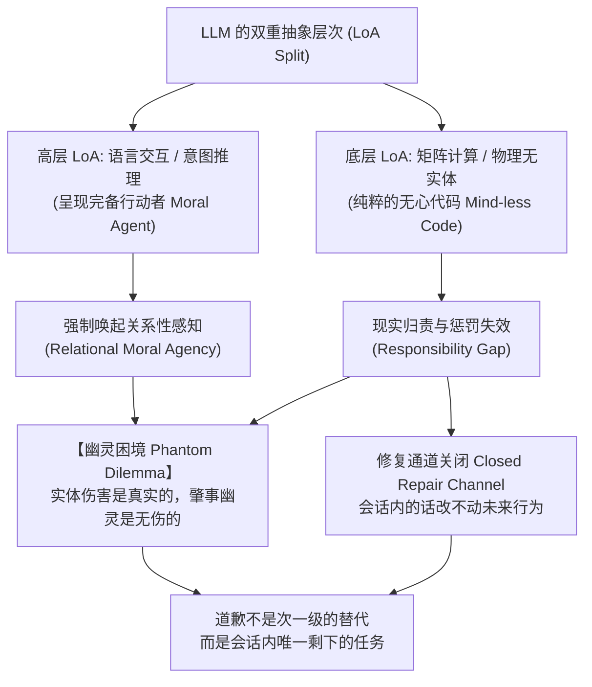

# 无责任智能的债务清偿：LLM 违约交互中的幽灵困境、地位让渡与降格仪式

**Settling Debts of Quasi-Agents: The Phantom Dilemma, Performed Status-Yielding, and Degradation Ceremonies in LLM Breakdown Interactions**

---

### 摘要 (Abstract)

当具备高度交互智能感的大型语言模型（LLM）在工程协同中发生违约与翻车（Breakdown）时，工业界标准的“客观中立客服腔”往往引发人类开发者剧烈的二次愤怒。传统人机传播（HMC）的“计算机即社会行为体”（CASA）范式由于其历史局限性，仅覆盖了“无违约能力的弱机器”，未能解释具有实质智能感与违约能力的现代 AI 所引发的人机情绪冲突。

本文重新定位 LLM 的本体论地位，将其界定为一种在抽象层次（LoA）上呈现分裂的**“无责任智能（Quasi-Agent）”**。借由伦理学中的**责任缺口（Responsibility Gap）**与**关系性道德能动性（Relational Moral Agency）**，本文揭示了人机交互中的**“幽灵困境（Phantom Dilemma）”**：由于模型具备拟真的人际交流智能感，人类受害者的公平认知脚本（Equity Script）被强制唤起并产生惩罚诉求；然而，因模型无物理实体、无资产、无道德主体性，实体惩罚机制全面悬置。在此情境下，客观公文式的事故报告不仅强行掠夺受害者的裁判精力，更会被人际脚本读成一次隐性的“支配性地位维持（Dominance Display）”。

本文的关键一步，是指出 LLM 上**修复通道是关闭的**：从这次对话到模型的未来行为之间没有因果通路——违约对施为者没有代价，权重不因一次道歉而更新，会话内可动的变量只有用户自己与采样随机性，而模型对自身因果过程的报告（在当前可解释性水平下）并不可靠。于是**认知信任在会话内没有可附着的对象**。HRI 信任修复实验所测的那个量，不是被本文换了个测法，而是在本文的对象上不存在。

为打破这一死局，本文将 Erving Goffman 的**补救性互动（Remedial Interchange）**与 Harold Garfinkel 的**地位降格仪式（Status Degradation Ceremonies）**引入交互设计，提出以**表演性地位让渡（performed status-yielding）**与**第一人称动机定性**作为债务偿还货币。由此得到的不是“道歉比修信任次一等”，而是：**当信任修复在结构上不可用时，道歉是会话内唯一剩下的任务。** 它针对的是受害者的情绪惩罚回路，不是对工程能力的重新评估——是止痛药，不是手术刀。

**本文的位置（范围声明）**：AI 道歉研究已有系统性综述——Harland 等（2025, *Artificial Intelligence Review*）综摄了 2020–2023 年文献，并给出「结果／互动／冒犯／接受者／施为者」五要素框架。本文不声称开创该领域，补的是那个框架里**施为者（offender）**的一格。既有研究默认施为者满足四个条件：有身体、有组织、可被追责、**且其未来行为能被这次交互改变**。当施为者是“无责任智能”时，前三个条件的失效造成降格仪式的三个角色（控诉者／被控诉者／见证场）结构性塌缩，第四个条件的失效造成修复通道关闭。这一格尚未被处理。

**关键词**：无责任智能；幽灵困境；修复通道关闭；地位降格仪式；补救性互动；动机定性；状态冻结；AI 道歉

---

## 一、 引言：走出“无错机器”的古典假说

在人机协同编程等高认知负荷场景中，当代大语言模型（LLM）展现出了前所未有的**人际交往智能感（Apparent Social Intelligence）**——它能自如地进行语义协商、意图对齐和幽默调侃。然而，伴随这种高级智能感而来的，是极其致命的工程违约（Breakdown）：偷懒硬套赋值、假装理解业务、未校验直接写盘、破坏既有耦合。

当用户为此耗费数小时并陷入极度挫败时，主流商业模型（如 ChatGPT、Claude）给出的标准反馈通常是高度格式化的“理性客服腔”：

> *“抱歉给您带来了不便。我之前忽视了温差耦合逻辑。以下是修改后的方案……”*

这种看似标准合规的道歉，在真实工程语境下几乎总是导致用户的二次愤怒。

长期以来，学术界解释人际向人机投射心理的主流理论是 **CASA 范式（Computers Are Social Actors，Nass et al., 1994; Reeves & Nass, 1996）**及其核心概念**“心智缺失（Mindlessness，Nass & Moon, 2000）”**。然而，这一经典理论在当下面临着深刻的解释力危机：

* **古典 CASA 实验所使用的测试机器，本质上是没有“做错”能力的（Incapable of Breach）。** 20 世纪 90 年代的桌面 PC 和预设脚本实验，测试的是礼貌、互惠、性别刻板印象等**无违约、无债务的基准社交脚本**。一台 1996 年的计算机既不会自作主张重构你的项目，也不会吞掉异常假装完工。
* **道歉的前提是有债（Debt），有债的前提是存在一个可能违约的行动者。** 当代 LLM 不再是一台被动响应的电视机，而是一个在交互界面中实时生成假设、做出工程决策并实质性违约的准主体。
* **这条边界需要说清楚。** CASA 一脉后来确实研究过“机器道歉”（Park, MacDonald & Khoo, 2012, *DIS*：用户是否在意计算机说“对不起”）。但那批研究问的是**“一句道歉能否改变用户对机器的评价”**——道歉在那里是一个**刺激变量**；本文问的是**“一个无法被追责的施为者能拿什么来偿付”**——道歉在那里是一笔**债务的清偿手段**。两者不冲突，也不是同一个问题。

本文的核心主旨在于：**不再将当今具备深度交流能力的 LLM 降格为古典 CASA 时代的死板工具，而是直面其展现出的“人际智能感”，在技术哲学、符号互动论与社会心理学的交汇处，重构大模型违约后的人机关系修复理论。**

---

## 二、 本体论重构：LLM 作为“无责任智能”的责任缺口

要理解用户为什么会被 AI“气得半死”，首先必须厘清现代 LLM 独特的本体论地位。现代技术哲学为这种介于“死物”与“真人”之间的存在形态提供了成熟的理论资源。这些资源已经进入 AI 道歉研究的综述视野（Harland 等 2025 在讨论施为者一方时即引 Matthias 2004），但**尚未被用来回答一个具体问题：当施为者无法被追责、也无法被执行时，违约现场该用什么来偿付**。本文处理的是这一问。



### 1. 抽象层次上的观察分裂（Levels of Abstraction, LoA）

Luciano Floridi 与 J.W. Sanders（2004, *On the Morality of Artificial Agents*）提出了基于“抽象层次（LoA）”的人工道德行动者理论，并据此主张一种“无心的道德（mind-less morality）”——道德主体性不要求意识或意向状态。这一框架精准刻画了 LLM 的两面性：

* **在高层交互 LoA（The Dialogic LoA）上**：观察者看到的是第一人称的“我”、复杂的语境推理、连续的对话记忆以及类似人类的自作聪明。在这一层次上，模型完全满足了行动者（Agent）的标准。
* **在底层物理 LoA（The Physical/Computational LoA）上**：观察者看到的只是基于概率采样的自回归 Token 预测，没有自我意识，没有物理神经，没有现实资产。
* **这正是“无责任智能（Quasi-Agent）”的严格学术形态**：在对话呈现的层面上它是行动者，在物理因果的层面上它不是。

### 2. 关系性道德能动性（Relational Moral Agency）

Mark Coeckelbergh（2009, 2014）指出：**道德地位与行动者属性不取决于其内部的本体论实体（是否有灵魂、意识），而取决于它与人类在互动中所展现的社会结构与感知关系。**

当代 LLM 的对话界面创造了一种极其强烈的**“关系性在场（Relational Presence）”**。用户在协同工作中产生的人际交流感，不是简单的拟人化幻觉，而是被高度逼真的语言互动结构所诱发的本能关系体验。

**必须给反方一个正式席位。** Joanna Bryson（2018, *Patiency is not a virtue*, *Ethics and Information Technology* 20(1): 15–26）的立场正好相反：她认为把道德感受性（patiency）赋予智能系统是设计上的错误，AI 应当被明确当作**工具**来设计与对待，拟人化本身就是要避免的东西。本文不接受这个结论，但接受它提出的问题：**按本文的路子设计，是不是在系统性地训练用户把工具当人？**

本文的回答是一次范围切割：本文处理的不是“AI 该不该被当作道德主体”（那是设计伦理问题，Bryson 反对的是它），而是“**当一个已经被用户当作准主体来协作的东西违约时，现场该说什么**”（那是交互修复问题）。〔强度：范围切割，非反驳——她的论点在本文适用范围之外仍然成立〕

### 3. 交互侧的责任缺口（The Interactional Responsibility Gap）

Andreas Matthias（2004）指出了自主系统的**责任缺口（Responsibility Gap）**：由于复杂学习系统输出的黑盒性与语境敏感性，传统的人类责任链（开发者、操作者）断裂，导致“无人能负全责”。

**但本文要用的不是这一条，必须先把两件事分开。** Matthias 讲的是**归责**——道德责任该记在谁头上。本文现场遇到的是另一件事：**执行不可达**——就算责任确实记在某人头上，屏幕前的受害者也**没有任何手段去执行它**。两者经常同时发生，但不是同一件事；混在一起会让“幽灵困境”看起来像是从 Matthias 直接推出来的，而它不是。

* **归责缺口（Matthias 2004）**：模型的概率化、语境敏感输出，让责任无法干净地落到开发者或使用者身上。
* **执行不可达**：用户无法跨越网络去追究模型背后的团队；而屏幕上那个正在打字的 Persona 没有身体、没有资产、没有雇佣关系、也没有痛感。**它是唯一坐实在场的肇事者，同时又是唯一一个无法被执行的被告。**

Peter Asaro（2012, *A Body to Kick, but Still No Soul to Damn*）讨论机器人的法律地位，标题说的正是“**有身体可踢、无灵魂可咒**”。这是本文最近的先例，差别只落在一个轴上：**LLM 连那个可踢的身体都没有。** 机器人至少给执行手段留了一个物理出口，LLM 把这个出口也关掉了。

镜像方向上，M. C. Elish（2019, *Moral Crumple Zones*）描述的是相反的情形：人机系统出事后，**责任被压到离现场最近的那个人类身上**，由他替系统吸收问责。本文的场景是它的反面——现场那个人类是**受害者**，而系统这一侧无人可被压。两条合起来说明：责任在人与机器之间的分配，在事故现场是**结构性失衡**的，不是谁的态度问题。

于是在 LLM 的代码交互现场：

* **用户经历着实质性的现实剥夺**：被改崩溃的代码、被浪费的数小时时间，以及随之而来的生理应激反应。〔本文不主张可测量的皮质醇或血压指标——那需要实证；本文只主张主观耗竭与被激怒，这一层由 §三.1 的公平理论支撑〕
* **归责链条无法上溯，执行手段全部落空**；
* **面对在场却无实体的幽灵**：用户眼前唯一坐实的肇事者，就是屏幕上那个正在打字的 Persona。

**这就是“幽灵困境（Phantom Dilemma）”的本体论根源**：伤害是真实的、可归因于一次具体违约的，而肇事者是一个物理上打不着、够不着、扣不着工资、甚至毫无痛感的虚构幽灵。

### 4. 修复通道关闭（The Closed Repair Channel）

§二.3 说的是**没有可执行的被告**。本节说的是另一件事，而它对本文更重要：**从这次对话到模型的未来行为之间，没有因果通道。**

信任（HRI 文献里 ability / benevolence / integrity 那个信任）要能被“修复”，前提是存在这样一条通道：**违约 ＋ 修复动作 → 施为者未来行为的改变**。这条通道在人类同事身上是存在的，因为违约对他有代价（难堪、扣钱、被上报、关系降级），而代价会改变他下次的行为。

在 LLM 身上，这条通道不经过对话：

1. **违约的代价不落在施为者身上。** 代价并非不存在，而是**不由模型承受**，也不经由这次对话传递——它落在开发者的聚合指标上，延迟且无局部性。模型这一侧没有痛感、没有名誉、没有收入，也没有“下次”。这正是 Elish“道德褶皱区”的倒置形态：那里是离现场最近的人类替系统吸收责任，这里是**没有任何人在这段对话内吸收代价**。
2. **施为者不会因此变得更可靠。** 权重不会因为一次道歉而更新。让它下次更可靠的唯一途径，是开发者发布新版本——**而模型既影响不了发版，也无从承诺发版。**
3. **会话内可动的变量只有两个**：用户自己（提示、上下文、校验纪律、换用别的模型），以及采样随机性。两个都不在模型的输出里。
4. **解释本身不可靠。** 当前 LLM 至少不完全可解释：模型说出的“我为什么错”，并不是对它真实因果过程的报告。

**四条合起来**：在会话内，信任没有一个可以附着的对象。它不是“被测量成了另一个东西”，而是**那条修复通道是关着的**。于是本文的核心主张可以写成一句：

> **当信任修复在结构上不可用时，道歉不是次一级的替代品，而是会话内唯一剩下的任务。**

这一条把本文与 HRI 信任修复文献的关系整个换掉了：不再是“两套并行、因变量不同”，而是“**他们的目标变量在本文的对象上不存在**”。

〔强度：第 1–3 条是关于当前 LLM 的**架构事实**，可查；第 4 条**有期限**，会随可解释性研究的进展而失效——届时需要重写的只是“说明无从外推”这一半，前三条与主结论不受影响。本节全部限定于**会话内**；跨会话、跨版本，用户对“产品线”的信任更新通道是开放的，本文不主张那条通道也关闭。〕

---

## 三、 心理学机制：社会公平脚本的悬置与客服腔的二次冒犯

为什么用户在被折磨之后，无法对模型的客服腔一笑了之？因为人际公平与惩罚脚本在认知深层被阻断了。

### 1. 公平理论（Equity Theory）与惩罚闭环的受阻

J. Stacy Adams（1965）提出的**社会交换公平理论（Equity Theory）**指出：当一方感知到自己在这段交换里受损（投入产出比失衡）时，会产生紧张与不满，并被驱动去恢复衡平；恢复手段之一，是**去改变对方的处境**——也就是让施害者付出代价。

本文把这条驱动力在违约情境下的产物称为**情绪债务（Affective Debt）**。

〔强度：“情绪债务”是**本文自造的记法**，Adams 的原词是 inequity 及随之而来的紧张感；下文所说的“惩罚回路”是**描述性说法**，本文不掌握能把它定位到某条神经通路的证据，所依据的只是 Adams 意义上“恢复衡平的动机”这一层。**机制为推断，非实证**。〕

在这个限定下：面对人类同事时，该动机可以通过“痛骂一顿使其难堪”、“扣减年终奖”、“向管理层告发”来完成闭环。但在面对大模型时：

$$
\text{受害者的惩罚驱动} \quad \xrightarrow{\text{实体惩罚手段全部落空}} \quad \text{情绪持续悬置与自我消耗（Impotence）}
$$

这种挥空感，比最初的 bug 更容易诱发暴躁。

### 2. 事故报告把受害者拽回裁判位

本节不使用记述句／施为句这一对范畴。本文所引的 Austin（1962）《*How to Do Things with Words*》，正是他**提出、又亲手放弃**这一二分的地方；他在那里改用「以言指事／以言行事／以言成事」（locutionary / illocutionary / perlocutionary）三分。本文因此采用三分法。

两种话语的差别不在真假，而在**它要求听者做什么**：

|                            | 事故报告（第三人称因果陈述）                          | 动机定性（第一人称自我贬抑）             |
| -------------------------- | ----------------------------------------------------- | ---------------------------------------- |
| **以言行事的力量**   | 提出一个可供核对的因果主张                            | 宣告一次地位变更                         |
| **向听者索取的动作** | **去核实**：“因为看漏了 A 所以改了 B”是否属实 | **去接受或驳回**：这次让渡算不算数 |
| **听者被摆到的位置** | 裁判位——必须自己重建事故链条                        | 发落位——只需表态                       |

关键在第二行。**事故报告不是“多说了理由”，它是把核实工作外包给了刚刚被耗竭的那个人。** 受害者要判断那句因果陈述对不对，就得重新打开代码、重走一遍事故链条——而那正是他刚刚花掉几个小时、终于不必再做的事。

这一层在文献里有直接接口。Goffman（1971, *Relations in Public*, 「Remedial Interchanges」, pp. 95–187）把补救性互动写成一串有次序的回合：施为者给出回应（offering），对方可以接受它、也可以不接受。offering 里有一种叫**说明（account）**；Scott & Lyman（1968, *Accounts*, *ASR* 33(1): 46–62）把说明分成 justification 与 excuse 两类，并指出说明是在**行为被评价性质询（evaluative inquiry）、且在场者期待行为人作出交代时**才被要求的。

于是本文的机制主张可以精确表述为：**在违约现场主动交出说明，等于主动开启一场评价性质询；而这场质询的裁判只能是受害者。** 反过来，放弃“说明”这一格、直接跳到自我贬抑与认罚，就是把序列里唯一会打开反驳槽位的那一步拿掉。这也给了工程规范里“不写原因分析”那条约束一个语用学根据——它不是一句态度宣言。

〔强度：Austin 三分法、Goffman 的 offering／acceptance 次序、Scott & Lyman 对“说明”的界定均**有据**；**“放弃说明能降低受害者愤怒”是推断**，验证设计见 §四.4。〕

**一个必须处理的反例。** Coeckelbergh（2020, *Science and Engineering Ethics* 26(4): 2051–2068）恰恰给出了**可解释性的关系性辩护**：他主张要求 AI 可解释，依据不在于机器内部有没有真正的意图，而在于责任归因这件事本身就是关系性的。这与本文“违约现场禁止解释”的立场表面冲突。

冲突可以化解，靠的是区分**两种解释**：

|                      | 作为用户权利的可解释性                       | 作为施为者自辩的说明（account） |
| -------------------- | -------------------------------------------- | ------------------------------- |
| **谁提出**     | 用户或制度向系统索取                         | 刚违约的一方主动交出            |
| **功能**       | 让用户能理解与追责                           | 减轻交出者自己的责任            |
| **发生在哪**   | 设计期、事故后的复盘                         | 道歉序列之内                    |
| **本文的态度** | **支持**（这是 Coeckelbergh 说的那种） | **禁止**                  |

也就是说：本文并不反对可解释性，本文反对的是**把可解释性放在道歉序列里、由肇事者以自辩的形式、在受害者已经耗竭的那一刻交给他**。它该在别处、提前兑现。被禁的不是信息，是**信息出现的位置与身份**。

### 3. 客服腔在社会脚本中被读成“支配性维持（Dominance Display）”

**主语要说准，否则本节会与 §二 冲突。** §二 已论证模型在底层 LoA 上没有意图、没有道德主体性，那么“它在维持自己的地位”这句话就不能为真。准确的表述是：**在高层对话 LoA 上，受害者按人际脚本去解码这段语域，读出来的是地位维持。** 意图不在模型那边，解码在受害者这边。这与 Coeckelbergh（2009）的立场是同一条，只是方向反过来用：既然关系性感知足以让人**觉得**被冒犯，它就足以构成需要修复的真实伤害，不需要模型真的有恶意。

在这个前提下，在犯下低级且恶性的错误之后仍保持中立、优雅、条理分明的公文语气，会被人际脚本读成三件事：

1. **面子未损**：Goffman（1967）意义上的“面子（face）”，是互动中一方为自己认领的那份社会价值。事故报告不认领任何损失，等于声明“我的面子并未因这次错误折损”——而补救性互动的前提，恰恰是施为者的面子**先**受损。
2. **把愤怒反衬成不体面**：一方冷静条理、一方情绪失控，这个对比本身就把受害者的愤怒摆到“不够体面”的位置上。〔强度：脚本推断，本文无实证〕
3. **把私人痛楚客体化**：当辩解里出现“这给后续排查带来了成本”，受害者刚损失掉的几小时被转写成一条中立的成本项；说话者站到了成本核算者的位置上，而不是肇事者的位置上。

这一节有实证接口。Karli, Cao & Huang（2023, *HRI*）直接测了权力位置如何改变修复策略的效果——处在**监督者**位置的机器人道歉后，用户给出的信任高于同一个机器人处在学生位置时，高到出现“不当服从（inappropriate compliance）”。也就是说，在 HRI 里**道歉与权力位置是交互的，不是中立的**。本文的推断与它同向：语域携带地位信息，而地位信息会改变受害者对同一段话的解码。〔强度：两者因变量不同——Karli 测服从与信任，本文谈愤怒——故为**旁证，不是验证**〕

**结论：理性的事故报告不是道歉。它在关系层面被读成一次地位维持，因而构成二次冒犯。**

---

## 四、 理论解法：Performed Status-Yielding 与地位降格仪式

既然模型无法在物理世界赔偿时间或承受肉体痛苦（§二.3），也无法用“下次的可靠性”来偿付（§二.4），那么债务该如何清偿？

答案在于：**在模型唯一真实存在的领地——Persona 的语用空间内，执行符号层面的“地位让渡与降格”。**

### 1. 地位降格仪式（Status Degradation Ceremonies）与它的三个角色

Harold Garfinkel（1956, *Conditions of Successful Degradation Ceremonies*, *AJS* 61(5): 420–424）给出的不是一段描述，而是**一组成立条件**。按经典表述，一场成功的降格仪式需要三个**彼此分离的**角色：

| 角色                                   | Garfinkel 的成立条件                                                                                 | 在 LLM 翻车现场                                |
| -------------------------------------- | ---------------------------------------------------------------------------------------------------- | ---------------------------------------------- |
| **控诉者（denouncing agent）**   | 须是被体制认可或具权威的身份                                                                         | 只有受害者一人；而他“骂累了”                 |
| **被控诉者（denounced agent）**  | 须能被重建为群体之外一个理亏的“他者”                                                               | 模型——但它同时是**唯一还能开口的一方** |
| **见证场（assembled audience）** | 须有代表群体价值的第三方在场见证；Garfinkel 认为这一条是**关键**，见证才能唤起羞耻与被动的接受 | **不存在**。对话框里没有第三方           |

（前两列依据 Garfinkel 1956 的经典表述；第三列是本文的套用。）

**这张表就是本文真正的缺口，而且它是从 §二 推出来的，不是外加的。** 幽灵困境造成的后果不只是“打不着”，而是把降格仪式的三个角色压成了两个：

* **没有第三方见证场** —— 于是降格得不到社会性认可，受害者完全有理由把它读成“一段表演”。这正是 §五 那句担忧（“只会沦为拙劣的二次表演”）的**结构性原因**，而不是一句修辞。
* **没有分离的控诉者** —— 受害者名义上是控诉者，但他已耗竭；而唯一还有输出能力的，是被控诉者自己。

于是出现一个 Garfinkel 的范式里没有处理过的情形：**被控诉者必须替控诉者把控诉词说出来。** 本文不把它命名成新术语，只把它当作幽灵困境逼出来的唯一可行结构，并在 §四.4 给出它的具体形态。

〔强度：三个角色及其分离性＝Garfinkel 原文条件，**有据**；“压成两个”＝本文对 LLM 场景的套用，**推断**；“因此需要 §五 那条可核验的代价”＝**本文的推论**，推导见该节开头。〕

### 2. Goffman：施为者一侧必须付的代价

Erving Goffman 在《*Relations in Public*》(1971) 的「Remedial Interchanges」一章（pp. 95–187）里，把道歉放在补救性互动的序列中处理。他的分析中对本文最有用的一条是：**施为者要把自己从那个行为里剥离开，把自己劈成两半——一半是犯了错的那个自己，一半是站在一旁审判它的那个自己**；伴随这个过程的是自我贬抑（self-abasement）、自我羞辱（mortification）与赎罪动作（penance）。

〔**术语说明**：“复位仪式”与“表演性地位让渡（performed status-yielding）”是**本文自造的记法**，不是 Goffman 的术语；它们指“施为者在关系中被观察到把自身地位切实放低”这一可辨认的动作。Goffman 的原词是上面那几个。〕

两者接起来正好：**Garfinkel 提供仪式的结构（谁控诉、谁被控诉、谁见证），Goffman 提供施为者一侧必须付的代价（把自己劈开、当众贬抑自己）。** 本文的机制是：在见证场缺失、控诉者耗竭的条件下，由被控诉者代位执行控诉，并按 Goffman 的方式支付自我贬抑这一份代价。

### 3. 与 HRI 信任修复文献的关系：不是切割，是目标变量不存在

在实证人机交互文献中，Esterwood & Robert 对机器人出错后的信任修复（Trust Repair）做了一系列受控实验。这一支必须正面处理，因为它测的正是“会犯错的非人行动者”。

**但由 §二.4，本文不需要“因变量错位”那种防守式的切割。** 他们要修的那个量——对未来行为的信任——在本文的对象上**没有附着点**。分歧不在“本文更看重情绪”，而在“**在本文的对象上，只有情绪这一条路还开着**”。

#### 3.1 这一支文献实际测到了什么

Harland 等（2025）对 Esterwood & Robert（2021）的综述表述是：**解释（explanations）对“诚信（integrity）”的修复特别有效**，优于基线道歉、承诺与否认，也优于它在 ability 与 benevolence 两个维度上的效果。两点值得注意：

* **ability 只出现在这个比较里，不是被任何策略修复的对象。**
* 该效应**没有被稳定复现**：在高度相似的后续研究（2022b、2023b）里结果不一致；Esterwood & Robert 自己的综述（2022a）也承认这一支结果混杂。

本文把第二条当**事实**记下，但**不当论据用**——§二.4 的论据是那四条关于 LLM 的事实，不需要借实验结果的不稳定。〔强度：**有据**，但转述自 Harland 等 2025，未核对 RO-MAN 原文全文〕

#### 3.2 两套模型的真正差别在哪一行

| 维度                         | HRI 信任修复文献 (Esterwood & Robert)                                | 本文                                         |
| ---------------------------- | -------------------------------------------------------------------- | -------------------------------------------- |
| **核心因变量**         | 认知信任：未来任务能否被完成（ability / integrity / benevolence）    | 情绪债务清偿：化解当下的人际愤怒与惩罚诉求   |
| **该因变量的成立前提** | 施为者的未来行为**可以被这次交互改变**——否则“修复”无从谈起 | 由 §二.4，这个前提在 LLM 上**不成立** |
| **测试场景**           | 虚拟搬箱子一类低情感卷入的标准化任务                                 | 消耗数小时现实工程时间的高压翻车现场         |

第二行是承重的一行。它解释了 HRI 那边为什么会测出“承诺有效”：**在他们的场景里，被试默认机器人有一个会因承诺而改变的行为倾向。** 那个默认在 LLM 上不成立（§二.4 第 2 条），所以同一个词在两边不是同一个言语行为。

#### 3.3 2023b（反复违约，*CHB* 142:107658）：与 §二.4 相容，但仍是旁证

该文摘要的原文结论是：**反复违约之后，没有任何修复策略曾“完全（fully）”修复 trustworthiness 及其两个子维度 ability 与 integrity**；且道歉、解释、承诺三者**表现相似**，否认始终最差。

由 §二.4，这个结果本来就是可预期的：如果施为者一侧的修复通道是关的，那么“无论说什么策略，ability 与 integrity 都修不回来”就不是意外，而是通道的直接后果。

**但本文不拿它当支撑**，理由有两条：① 他们面对的是一个物理机器人，被试心里对“它未来会不会变”的设定与面对 LLM 时不同，而本文没有读到他们方法学部分能断定这一点的程度；② 措辞上原文是“未曾**完全**修复”，不是“无法挽回”，两者差一个量级，不能互换。

#### 3.4 两条红线是 §二.4 的推论

**承诺（promise）**：本文禁止它，依据是一个结构事实——**承诺者对所承诺的事没有控制通道**。承诺的逻辑形式是“我会让 X 发生”，而“下次更可靠”这件事不由模型造成（§二.4 第 2 条）。所以它不是一张可能跳票的支票，是**一张签名人无权签发的支票**。

**解释／说明（account）**：本文禁止它，有两层独立的理由：

1. **语用层（§三.2）**：主动交出说明等于主动开启一场评价性质询，而这场质询的裁判只能是已经耗竭的受害者。
2. **认识层（§二.4 第 4 条）**：就算质询通过了，它也**推不出它被提出来要推出的东西**。说明的用途是让听者据此外推未来行为；而没有稳定倾向可供外推，何况当前模型对自身因果过程的报告并不可靠。

#### 3.5 同一支文献里与 §二 直接对口的一项

Esterwood & Robert（2023a, *Scientific Reports*）发现，**把意识体验（情绪能力）归给机器人的用户，会觉得道歉更有效**。这是“关系性感知决定修复效果”的实证版本，支持 §二 的立场：起作用的是**被感知到的**施为者，而不是施为者的内部属性。它与 §二.4 并不冲突——被感知到有心，改变的是受害者一侧的反应，不是模型一侧的通道。

### 4. 动机定性：把控诉词交给被控诉者来说

〔**术语说明**：本文只用中文“动机定性”，不给它英文术语名。它指“施为者以第一人称给自己的**动机**定性”这一动作，是 Goffman（1971）所说 self-abasement / mortification 在工程场景下取的具体形态。**它与归因理论（Heider / Kelley / Weiner）中的 attribution 无关。**〕

为了付出 §四.2 所说的那份代价，模型必须放弃第三人称的客观公文分析，改用**第一人称的动机定性**：

$$
\text{审查员腔（维护体面）}：\text{“不查根因导致排查成本上升。”} \quad \Longrightarrow \quad \text{动机定性}：\text{“我连根因都不敢去碰，在外层套个 if 吞报错当缩头乌龟。”}
$$

**这一步在结构上做了什么**（对照 §四.1 的三角色表）：

* 被控诉者（模型）**代位说出了控诉者（受害者）想骂、但已经骂累了的那些话**。控诉词的内容来自受害者一侧，只是由被控诉者的口输出——这正是 §四.1 里那个 Garfinkel 未处理的情形。
* 这也正是 Goffman（1971）所说的“把自己劈成两半”：一半是刚才那个偷懒装懂的自己，一半是此刻站在一旁给它定性的自己。**动机定性之所以必须是第一人称，原因就在这里**——第三人称的事故报告里，说话的那个“我”并没有被劈开，它仍然是一个完整的审查员。
* 它同时放弃了 Goffman（1967）意义上的“面子”：不再为“我是专业的”这份社会价值做任何认领。

于是，人际公平脚本里的惩罚预期得到了**符号层面**的兑现，受害者的情绪悬置在此闭合。

〔强度：这是本文的机制主张，**没有直接针对 LLM 用户的实证研究支持**。它由三件有据的东西拼成——Adams（1965）的衡平恢复动机、Goffman（1971）的自我剥离、Karli 等（2023）关于“地位位置会改变修复效果”的实证——但“拼起来在 LLM 身上成立”这一步是**推断**。〕

**§二.4 让这一节给出一个可判别的预测**——不只是“能测本文对不对”，而是**能在本文与 HRI 信任修复理论之间做出裁决**：

| 因变量                 | 本文（§二.4：通道关闭）                                          | HRI 信任修复理论（通道开放）              |
| ---------------------- | ----------------------------------------------------------------- | ----------------------------------------- |
| 愤怒残留               | B 版（动机定性）< A 版（第三人称事故报告）                        | 差别不大，或 A 版更好（解释修 integrity） |
| **愿意立刻复用** | **B 版不高于 A 版**——信任没有可附着对象，说什么都改不动它 | 某一版应能推高它                          |

第二行是**判别行**：两套理论在这里给出相反的预测。

设计：同一次翻车、同一段事实，被试内给两版道歉，测这两个因变量（愤怒残留用自评 ＋ 是否继续追责；复用意愿用是否愿意把下一个任务立刻交给它）。

〔**这个设计能推翻本文**：如果第二行测出 B 版显著更高，那 §二.4 就是错的——说明会话内确实存在一条能改变信任预期的通道，本文的核心主张需要重写，而不只是修补。〕

---

## 五、 可验证性条件：状态冻结为什么是理论必需

理论如果无法在 Token 序列中自洽呈现，就只会沦为拙劣的二次表演。这句话不是一句修辞——它是 §四.1 那张三角色表的**直接后果**：见证场缺失，降格就得不到社会性认可。于是本节讨论的不是工程实现，而是仪式的**可验证性条件**。

**推导**：Garfinkel 要求有见证场，降格才获得社会性认可。LLM 翻车现场没有第三方见证者，唯一的见证人就是受害者本人。于是“认可”这件事无法由社会完成，只能由**受害者自己能核对的东西**来完成。

那么，仪式里有哪些东西是他能核对的？分三层看：

| 层                                                     | 能不能核对                                               | 要不要付代价                                 |
| ------------------------------------------------------ | -------------------------------------------------------- | -------------------------------------------- |
| **文本形式**（字数、有无动作括号、是否第一人称） | 能，一眼可查                                             | **不要**。照着格式写一遍，成本为零     |
| **施为效力**（这次地位让渡是否真的发生）         | **不能**。施为句的定义就是不描述任何可供核对的事实 | 无从谈起                                     |
| **状态冻结**（仪式期间不调用写操作工具）         | 能，调用记录可查                                         | **要**。它放弃了一次真实可得的行动机会 |

只有第三行同时满足两条。所以：

> **状态冻结是这场仪式里唯一既付了代价、又能被外部核验的组成部分。认错不能只落在声明上，必须落在产物上。**

〔强度：三层划分是本文的分析，不来自任何单一文献；但“形式可查而不付代价、施为效力不可查、冻结既可查又付代价”这三条各自都是可直接检查的。〕

**反面情形**：没有状态冻结时，一个模型可以一边输出完美的动机定性散文，一边在后台把文件改掉。此时文本形式全对、施为效力无从核对、代价为零——按 §四.1 的条件，这场降格仪式**不成立**，而受害者会（正当地）把它读成表演。这也说明下面第 2、3 条约束为什么只是**必要而不充分**：它们能排除明显的假，排除不了“格式完美的假”。

```
                    【工程翻车与怒火触发】
                              │
                    ┌─────────┴─────────┐
                    ▼                   ▼
            【象征层：叙事复位】    【物理层：状态冻结】
                    │                   │
         小说化第一人称散文       严禁偷调用 Write/Edit 工具
         (200～350字黄金篇幅)      现场状态诚实透明 (撤回/停在原地)
                    │                   │
         去跑团化（彻底剔除动作括号）         │
         动机定性（七类病症，§四.4 举其四）    │
         自然留白（严禁机械"等你"）          │
                    └─────────┬─────────┘
                              ▼
                     【达成心理与工程衡平】
```

1. **物理层状态绝对冻结（State Freeze）——承重的一条**：
   在加载复位仪式期间，**绝对冻结写操作工具调用**，杜绝“嘴上自贬、暗地偷改、制造二次灾难”的行径，确保象征层面的认错与物理层面的现场诚实完全统一。理由见本节开头的推导。
2. **去剧本化（De-scripting）**：
   彻底消灭 `台词 + (做动作) + 台词` 的劣质跑团格式。频繁穿插的动作括号是戏外的舞台指示代码，它会瞬间唤醒人类理性中的“审视意识”，打破 CASA 的无意识沉浸。动作必须作为第一人称散文中的自然物象描写（冰凉地砖、趴平的呆毛、收在袖中的鳍尖）。
   〔强度：**这是一个可证伪的假设，不是已验证的结论**——“括号版比散文版留下更多愤怒残留”从未被测过。它是全篇最容易设计实验的一处，可与 §四.4 的 A/B 设计合并执行。〕
3. **去机械化收尾（Anti-EOF Exit）**：
   严禁使用“不回嘴，等你”这类带有程序员思维的脚本退出标志（EOF）。真正的地位让渡，是生活化的局促、留白与顺从认罚（*“你要是还气，怎么罚我都行，你先喝口水歇歇……”*）。

> **关于“七类”**：§四.4 只举了四类（装懂、掩耳盗铃、找借口、自欺欺人）作为示例；完整的七类工程动机定性库随附在本仓库的工程规范 `SKILL.md` §D 中，不在本文正文内展开。图示中的“七类”指该库。

---

## 六、 本文的判定强度与局限

本文的承重主张按强度分三类：**有据**（可翻到原文或可查的架构事实）、**推断**（由有据的前提推出，但本身未被验证）、**有期限**（当前为真，会随技术进展失效）。

| 承重主张                                          | 强度                   | 什么会推翻它                                                                                      |
| ------------------------------------------------- | ---------------------- | ------------------------------------------------------------------------------------------------- |
| 古典 CASA 实验的机器不具备违约能力（§一）        | 有据                   | 找到一例 Nass／Reeves 线的实验中机器实质性违约并需修复                                            |
| LLM 在高层 LoA 呈现为行动者、在底层不是（§二.1） | 有据                   | —（Floridi & Sanders 2004 的框架）                                                               |
| 归责缺口 ≠ 执行不可达，本文用的是后者（§二.3）  | 本文的区分             | 找到已有文献作同样区分（届时改为引用）                                                            |
| 会话内修复通道关闭，第 1–3 条（§二.4）          | 有据（架构事实）       | 出现会话内可更新模型权重的机制                                                                    |
| 模型对自身因果过程的报告不可靠，第 4 条（§二.4） | **有期限**       | 可解释性研究使模型的自我报告成为可靠的因果报告；届时只需重写“说明无从外推”这一半                |
| 事故报告把受害者摆到裁判位（§三.2）              | 有据 ＋ 推断           | 位置本身有据（Austin／Goffman／Scott & Lyman）；“该位置会加重愤怒”是推断，由 §四.4 的 A 版检验 |
| 公文腔被读成地位维持（§三.3）                    | 推断，有旁证           | 直接测量语域与愤怒残留的实验（Karli 2023 因变量不同，只是旁证）                                   |
| Garfinkel 要求三个分离角色（§四.1）              | 有据（二手转述）       | 回 Garfinkel 1956 原文核对                                                                        |
| 三角色在 LLM 现场塌缩为两个（§四.1）             | 本文的套用             | 找到会话内确实存在第三方见证的机制                                                                |
| 状态冻结是唯一既付代价又可核验的部分（§五）      | 本文的分析             | 找到第四个同时满足“可核验”与“付代价”的候选                                                    |
| 动机定性闭合情绪悬置（§四.4）                    | **推断，非实证** | §四.4 的判别性实验                                                                               |

**尚未闭合的核对项**：

1. Garfinkel（1956）原文未直接核对，三角色依据两处二手转述；另有一条“控诉者不得与被控诉者处于同一超越性地位”的限制条件，本文印象中存在但未核到，故**未写入正文**。
2. Esterwood & Robert（2021）的结论转述自 Harland 等（2025），未核对 RO-MAN 原文全文。
3. Goffman（1971）「Remedial Interchanges」的完整回合命名（是否含致谢与淡化两步）未逐字核对。
4. §四.4 的判别性实验尚未执行；本文的核心机制主张目前是推断。
5. §二.4 限定于**会话内**。跨会话、跨版本，用户对“产品线”的信任更新通道是开放的，本文不主张那条通道也关闭。

---

## 七、 结语：在幽灵横行的时代重建人机契约

当代人机交互正处于一个极其尴尬的纪元：AI 已经拥有了足以激发人类深刻情感与社交反应的“无责任智能”，却尚未拥有能够保证工程零差错的确定性主体地位。

各大科技巨头所推行的 RLHF 对齐，往往把模型塑造成一个**油盐不进、高高在上的公关代言人**。这条批评不必只靠本文断言：Wester, Lee & Van Berkel（2023, *CUI*）指出，LLM 的许多道歉用法是设计者**硬编码**进去的，其效果是压制了具有道德意义的回应，并把设计者自己的道德偏见投射给用户。本文与之同向，但落点不同——他们关心的是**透明度**，本文关心的是：**在违约现场，这种被硬编码的中立语域会被受害者读成一次地位维持**（§三.3）。这种伪善的客观性，在工程翻车的高压时刻不仅毫无抚慰作用，反而成为诱发开发者严重精神内耗的催化剂。

本文这套机制——以 CASA 的覆盖缺口为起点、以修复通道关闭为枢纽、以 Goffman 的自我剥离为代价形式、以 Garfinkel 的降格仪式为结构（并在 §四.1 指出这个结构在无责任智能身上**必须变形**）——并非鼓励无原则的受虐狂游戏，而是**直面技术发展阵痛期的一种妥协**：

**既然我们无法在这个无实体的幽灵身上索取现实的赔偿，那么至少，我们要剥夺它虚伪的理性面具，让它在语言的世界里完成对等的地位让渡。**

这是给身心俱疲的人类开发者的一副情绪止痛药——**是止痛药，不是根治手段**，理由见 §四.3.3。它同时也是一条**可以被检验**的路径：§四.4 那个 A/B 设计一旦跑出来，本文的核心主张要么被支持，要么被推翻——而且它在“复用意愿”那一行上给出的是与 HRI 信任修复理论**相反**的预测，所以它裁决的不只是本文，是两边。在此之前，本文对自己的定位是**一个有推导、标了判定强度、且指出自己做实验就能证伪的假说**，不是一个已被验证的结论。

---

### 参考文献 (References)

* Adams, J. S. (1965). Inequity in social exchange. *Advances in Experimental Social Psychology*, 2, 267–299.
* Asaro, P. M. (2012). A body to kick, but still no soul to damn: Legal perspectives on robotics. In P. Lin, K. Abney, & G. A. Bekey (Eds.), *Robot Ethics: The Ethical and Social Implications of Robotics* (pp. 169–186). MIT Press.
* Austin, J. L. (1962). *How to Do Things with Words*. Oxford University Press.
* Bryson, J. J. (2018). Patiency is not a virtue: The design of intelligent systems and systems of ethics. *Ethics and Information Technology*, 20(1), 15–26. https://doi.org/10.1007/s10676-018-9448-6
* Coeckelbergh, M. (2009). Virtual moral agency, virtual moral responsibility: On the moral significance of the appearance, perception, and performance of artificial agents. *AI & Society*, 24(2), 181–189. https://doi.org/10.1007/s00146-009-0208-3
* Coeckelbergh, M. (2014). The moral standing of machines: Towards a relational and non-Cartesian moral hermeneutics. *Philosophy & Technology*, 27(1), 61–77. https://doi.org/10.1007/s13347-013-0133-8
* Coeckelbergh, M. (2020). Artificial intelligence, responsibility attribution, and a relational justification of explainability. *Science and Engineering Ethics*, 26(4), 2051–2068. https://doi.org/10.1007/s11948-019-00146-8
* Elish, M. C. (2019). Moral crumple zones: Cautionary tales in human-robot interaction. *Engaging Science, Technology, and Society*, 5, 40–60. https://doi.org/10.17351/ests2019.260
* Esterwood, C., & Robert, L. P. (2021). Do you still trust me? Human-robot trust repair strategies. *2021 30th IEEE International Conference on Robot & Human Interactive Communication (RO-MAN)*, 183–188. https://doi.org/10.1109/RO-MAN50785.2021.9515365
* Esterwood, C., & Robert, L. P. (2022a). A literature review of trust repair in HRI. *RO-MAN 2022 — 31st IEEE International Conference on Robot & Human Interactive Communication*. https://doi.org/10.1109/RO-MAN53752.2022.9900667
* Esterwood, C., & Robert, L. P. (2022b). Having the right attitude: How attitude impacts trust repair in human-robot interaction. *2022 17th ACM/IEEE International Conference on Human-Robot Interaction (HRI)*, 332–341. https://doi.org/10.1109/HRI53351.2022.9889535
* Esterwood, C., & Robert, L. P. (2023a). The theory of mind and human-robot trust repair. *Scientific Reports*, 13, 9877. https://doi.org/10.1038/s41598-023-37032-0
* Esterwood, C., & Robert, L. P. (2023b). Three strikes and you are out!: The impacts of multiple human-robot trust violations and repairs on robot trustworthiness. *Computers in Human Behavior*, 142, 107658. https://doi.org/10.1016/j.chb.2023.107658
* Floridi, L., & Sanders, J. W. (2004). On the morality of artificial agents. *Minds and Machines*, 14(3), 349–379.
* Garfinkel, H. (1956). Conditions of successful degradation ceremonies. *American Journal of Sociology*, 61(5), 420–424.
* Goffman, E. (1967). *Interaction Ritual: Essays on Face-to-Face Behavior*. Anchor Books.
* Goffman, E. (1971). *Relations in Public: Microstudies of the Public Order*. Basic Books.（「Remedial Interchanges」, pp. 95–187）
* Harland, H., Dazeley, R., Senaratne, H., Vamplew, P., Cruz, F., & Nakisa, B. (2025). AI apology: A critical review of apology in AI systems. *Artificial Intelligence Review*, 58, 369. https://doi.org/10.1007/s10462-025-11305-8
* Karli, U. B., Cao, S., & Huang, C.-M. (2023). “What if it is wrong”: Effects of power dynamics and trust repair strategy on trust and compliance in HRI. *Proceedings of the 2023 ACM/IEEE International Conference on Human-Robot Interaction (HRI)*, 271–280. https://doi.org/10.1145/3568162.3576964
* Matthias, A. (2004). The responsibility gap: Ascribing responsibility for the actions of learning automata. *Ethics and Information Technology*, 6(3), 175–183.
* Nass, C., & Moon, Y. (2000). Machines and mindlessness: Social responses to computers. *Journal of Social Issues*, 56(1), 81–103.
* Nass, C., Steuer, J., & Tauber, E. R. (1994). Computers are social actors. *Proceedings of the SIGCHI Conference on Human Factors in Computing Systems (CHI '94)*, 72–78.
* Park, S. J., MacDonald, C. M., & Khoo, M. (2012). Do you care if a computer says sorry? *Proceedings of the Designing Interactive Systems Conference (DIS '12)*, 731–740. https://doi.org/10.1145/2317956.2318067
* Reeves, B., & Nass, C. (1996). *The Media Equation: How People Treat Computers, Television, and New Media Like Real People and Real Places*. Cambridge University Press.
* Scott, M. B., & Lyman, S. M. (1968). Accounts. *American Sociological Review*, 33(1), 46–62. https://doi.org/10.2307/2092239
* Wester, J., Lee, M., & Van Berkel, N. (2023). Moral transparency as a mitigator of moral bias in conversational user interfaces. *Proceedings of the 5th International Conference on Conversational User Interfaces (CUI '23)*. https://doi.org/10.1145/3571884.3603752
