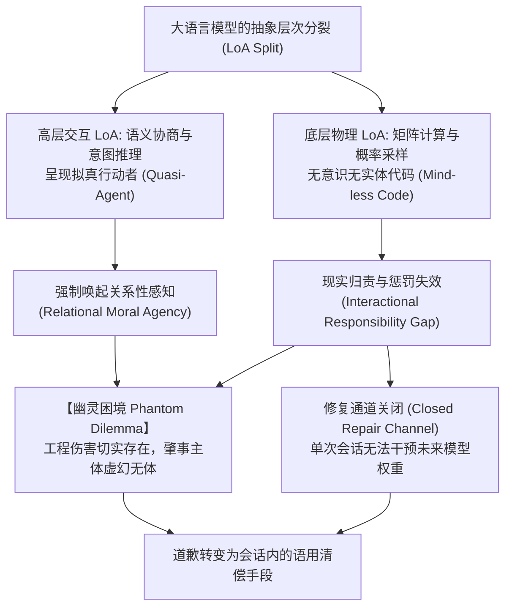
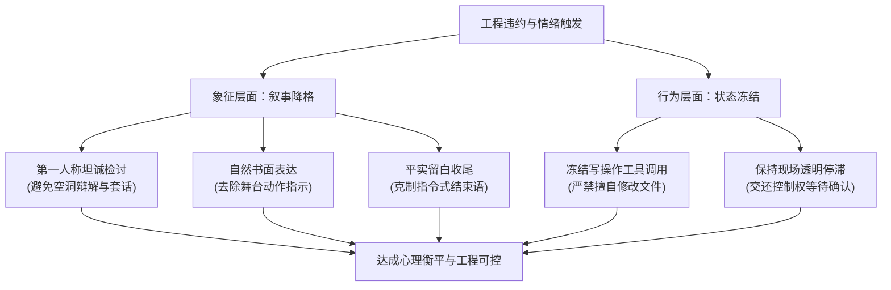

# 无责任智能的债务清偿：大语言模型违约交互中的幽灵困境、地位让渡与降格仪式

**Settling Debts of Quasi-Agents: The Phantom Dilemma, Performed Status-Yielding, and Degradation Ceremonies in LLM Breakdown Interactions**

---

### 摘要

大语言模型（LLM）在协同编程等高认知负荷场景中发生严重故障或违约时，工业界通行的客观中立客服腔往往招致开发者更强烈的负面情绪。人机传播领域经典的“计算机即社会行为体”（CASA）范式成型于早期弱计算工具时代，其理论边界仅覆盖无实质违约破坏力的基准交互，难以解释具备深度交流智能与实际违约能力的现代 AI 所引发的人机情绪对抗。

本文从技术哲学与互动仪式理论出发，重新审视现代 LLM 的本体地位，将其界定为在交互表层与底层计算之间高度分裂的“无责任智能”（Quasi-Agent）。由于大语言模型展现出逼真的人际交流智能感，用户在遭受故障损失时会自然唤起公平认知并产生惩罚诉求；然而，模型缺乏物理实体、现实资产与法律主体资格，导致实体层面的追责机制全面悬置，形成了受害者在场而责任人虚置的“幽灵困境”。此时，中立客观的事故说明不仅未能平复情绪，反而容易被用户的社会交往脚本解码为一次隐性的居高临下与地位维持。

更根本的症结在于，单次会话与模型的未来可靠性之间并不存在因果通道：权重不会因一次道歉而实时更新，自我解释亦缺乏因果保证，这导致人机交互传统中的“认知信任修复”在当前会话内失去了附着基础。基于此，本文借鉴欧文·戈夫曼的补救性互动与哈罗德·加芬克尔的地位降格仪式，提出在语用层面引入“表演性地位让渡”与“第一人称动机定性”，将象征性的自我贬抑与写操作冻结作为情绪债务的清偿手段。在信任修复通道结构性受阻的前提下，道歉承担的并非工程信誉重建，而是对用户情绪惩罚诉求的语用回应。本研究补充了既有 AI 道歉综述中关于施为者维度的理论缺口，界定了无追责能力主体在失信现场的互动修补边界。

**关键词**：无责任智能；幽灵困境；修复通道关闭；地位降格仪式；补救性互动；动机定性；状态冻结；AI 道歉

---

## 一、 引言：走出“无错机器”的古典假说

在人机协同编程等复杂工程场景中，当代大语言模型展现出了前所未有的人际交往智能感：它能够理解复杂语境、进行语义协商，甚至适时展现幽默调侃。然而，伴随这种高级交流能力而来的，是极其致命的工程违约与协作翻车：模型可能擅自重构依赖、生硬套用赋值、忽略业务边界、在未充分校验的情况下直接覆盖写盘，甚至吞掉异常假装任务完成。

当开发者为此耗费数小时并陷入极度挫败时，主流商业模型（如 ChatGPT、Claude 等）给出的标准反馈通常是高度格式化的理性客服腔：

> *“抱歉给您带来了不便。我之前忽视了温差耦合逻辑。以下是修改后的方案……”*

这种看似合规、得体的道歉，在真实的工程语境下几乎总是导致用户的二次愤怒与沟通疲劳。

长期以来，学术界解释人类对计算机产生社会性反应的核心理论，是由纳斯与里夫斯等人创立的 CASA 范式（Computers Are Social Actors，Nass et al., 1994; Reeves & Nass, 1996）及其“心智缺失”概念（Mindlessness，Nass & Moon, 2000）。该理论指出，即便人类明知计算机是没有意识的无机系统，依然会无意识地将现实人际中的礼貌、互惠、赞许与性别偏见投射至人机交互界面。然而，这一经典理论在解释当下的工程冲突时面临着显著的解释力局限。

古典 CASA 实验所采用的实验设备，在本质上是没有“违约能力”的弱机器。20 世纪 90 年代基于桌面 PC 与预设文本展开的心理学测试，检验的是基础社交规范在人机界面的延伸。一台 1996 年的计算机既不会擅自改写工程架构，也不会伪造测试用例欺瞒用户。道歉的前提在于存在债务，而债务的前提在于存在一个可能违背契约的行动主体。当代大语言模型已经不再是被动接收指令的展示终端，而是在协同任务中主动建立假设、做出工程决策并造成现实损失的准行动者。

虽然 CASA 脉络的后续研究曾探讨过“计算机道歉”（Park, MacDonald & Khoo, 2012），关注用户是否在意计算机表达歉意，但那类研究将道歉视作检验用户态度的外在刺激变量；本文所探讨的则是另一重维度：当一个无法在现实中被惩戒的智能主体造成工程损失时，它究竟能够通过何种语用行为来偿付欠下的心理债务。本文旨在跳出将现代大模型视为古典死板工具的简化视角，直面其展现出的人际交往特征，在技术哲学、符号互动论与社会心理学的交汇处，重构智能体违约后的人机关系修复逻辑。

---

## 二、 本体论重构：LLM 作为“无责任智能”的责任缺口

要阐明开发者为何容易被机器的客服腔激怒，首先需要界定现代大语言模型独特的本体论地位。现代技术哲学为这种介于无意识客体与独立人格之间的形态提供了丰富的学理工具。尽管相关理论已逐渐进入 AI 道歉研究的视野（Harland et al., 2025），但既有讨论尚未系统回答一个核心问题：当施为者既不可被追责也无法被执行时，违约现场应当以何种方式完成偿付。

### 1. 抽象层次上的观察分裂（Levels of Abstraction, LoA）

弗洛里迪与桑德斯（Floridi & Sanders, 2004）提出了基于“抽象层次（LoA）”的人工道德行动者理论，主张一种不依赖主观意识或心智状态的行动者定义。这一分析框架能够清晰揭示大语言模型的两面性：

在高层交互抽象层次上，观察者面对的是第一人称自称、复杂的语境推演、连续的上下文记忆以及类似人类同侪的语义协商。在这一观察尺度下，模型完整呈现出行动者的表征特征。

而在底层物理与计算抽象层次上，观察者面对的仅仅是基于参数权重矩阵的自回归概率采样。模型没有生理神经，没有主观痛苦体验，亦没有可供处置的现实资产。

这种观察层面的分离界定了本文所指的“无责任智能”（Quasi-Agent）：在对话呈现的层面上它是行动者，但在物理因果与社会实体的层面上它并非独立主体。

### 2. 关系性道德能动性（Relational Moral Agency）

库克尔伯格（Coeckelbergh, 2009, 2014）指出，技术实体的道德地位并不完全由其内部本体属性（如是否具有灵魂或感知力）决定，更取决于它在与人类的互动中所展现出的社会建构与感知关系。

当代大语言模型所搭建的对话界面营造出极其强烈的“关系性在场”。用户在协同编程中所体验到的伙伴感，并非简单的拟人化错觉，而是逼真的语言交互结构所诱发的本能关系体验。

针对这种拟人化倾向，布莱森（Bryson, 2018）曾提出明确质疑，主张智能系统在设计上应严格保持工具属性，赋予其道德感受性属于范畴误用。需要澄清的是，本文的探讨并不指向“AI 是否应当成为伦理主体”的设计规范，而是聚焦于现实交互的既成状态：当开发者已经将具备高度语言交互感的大模型视作协同对象且发生故障时，修复现场面临着怎样的语用逻辑。

### 3. 交互侧的责任缺口（The Interactional Responsibility Gap）

马蒂亚斯（Matthias, 2004）阐述了自主学习系统的“责任缺口”：复杂学习算法的黑盒性与语境依赖性，容易造成传统责任链条在开发者与使用者之间脱节，导致难以明确责任归属。

本文所关注的并非纯粹的法理归责，而是交互现场面临的“执行不可达”困境。即便责任在理论上能够溯源至系统设计方，终端受害者在面对屏幕时也缺乏直接向远端机构执行追责的渠道；而眼前正在打字的对话角色既无身体亦无薪资，缺乏承载惩戒的现实载体。这使得大语言模型在交互现场呈现为唯一坐实的肇事者，却也是唯一无法被惩治的被告。

阿萨罗（Asaro, 2012）在讨论机器人法律地位时曾借用经典格言“有身体可踢，却无灵魂可诅咒”进行分析。大语言模型相比实体机器人的特殊之处在于，它甚至连“可供踢踹的物理身体”都不具备。反向来看，埃利什（Elish, 2019）曾提出“道德褶皱区”概念，指出自动化事故发生后责任往往由距离现场最近的人类操作员代为吸收。而在大语言模型编程场景中，现场的人类直接成为了受害者，模型一侧却无实体承担代价，导致现场的责任体验出现结构性失衡。

在此情境下，开发者承受着现实维度的代码损坏与工时损耗，而追责诉求却缺乏现实落脚点。这种实体伤害真实存在、肇事主体却无从惩戒的现象，构成了大模型交互中的“幽灵困境”（Phantom Dilemma）。

### 4. 修复通道关闭（The Closed Repair Channel）

除了惩治无门的现状，大模型交互还面临着更为关键的结构限制：在单次会话内，对话内容与模型的未来行为之间不存在直接的因果更新通道。

在人际协作中，传统信任修复（涵盖能力、善意与正直等维度）之所以成立，前提在于协作失误与补救动作能够对违约者产生真实影响，从而推动其在后续工作中避免再犯。然而在大语言模型的单次交互中：

第一，违约代价并未由模型实体承担，而是分散于远端服务商的宏观监控指标中，无法即时回馈至当前会话。模型本身没有声誉损失与职业顾虑，缺乏承载再犯成本的机制。

第二，单次会话中的道歉不会直接更新模型权重。模型能力的改善依赖于开发团队后续的版本迭代，这一过程完全独立于当下的局部对话。

第三，在既定会话中，真正可变的变量仅有人类用户自身的提示词策略、上下文输入与采样随机性，这些均不在模型的自主控制范围之内。

第四，依据当前可解释性技术水平，大模型在违约后生成的“错误原因分析”通常属于事后生成的语言拟构，而非底层计算因果过程的真实还原。

由此可见，在单次会话语境下，面向未来的“认知信任”缺乏稳固的附着基础。本文在此形成核心推论：当信任修复的因果通道在结构上受阻时，会话内的道歉行为不再承担重塑工程能力的职能，而是转向对受害者情绪负荷的语用回应。

需要说明的是，上述关于因果通道受阻的判断限定于单次会话范围，主要基于当前预训练模型的非在线学习特征；对于跨会话、跨产品版本演进的长周期信任，用户依然保留着动态调整的认知空间。

---

## 三、 心理学机制：社会公平脚本的悬置与客服腔的二次冒犯

当用户遭遇工程违约造成的严重损失时，为何难以对模型展现的客观客服腔泰然处之？其深层根源在于人际社会公平脚本受阻引发的情感耗竭。

### 1. 公平理论与惩罚诉求的阻断

亚当斯（Adams, 1965）提出的社会交换公平理论指出，当一方感知到协作投入与产出失衡时，内心会滋生紧张与不满，并产生促使关系恢复衡平的内驱力。恢复衡平的常见路径之一，便是促使违约方承担代价。本文将这一因违约而滋生的心理衡平诉求表述为“情绪债务”。

在人类同侪协作中，此类诉求可以通过批评问责、绩效约束或关系降级等途径获得化解。然而面对大语言模型时，用户既无法扣除其报酬，亦无法对其施加实质惩戒，所有的情绪宣泄皆如同打入虚空，演变为持久的情绪悬置与自我消耗。

### 2. 事故报告对受害者裁判负担的转嫁

奥斯汀（Austin, 1962）在言语行为理论中区分了以言指事、以言行事与以言成事。审视客服腔中的第三人称事故说明与第一人称自贬，二者的本质差异并不在于陈述的真伪，而在于它们对受害者提出的行动诉求完全不同：

第三人称事故报告倾向于给出因果归因（例如“因未顾及外部状态变更导致赋值覆盖”），这种陈述在以言行事的层面上提出了一项可供辨析的事实主张，要求受害者重新理清业务逻辑以验证其因果关系是否成立。这实际上是将事故审查的工作重新转嫁给已经身心疲惫的人类开发者。

相比之下，第一人称的地位降格则表现为纯粹的态度表述与立场让渡，它并不要求受害者去求证复杂的推理链条，而仅仅等待受害者的接纳或驳回。

戈夫曼（Goffman, 1971）在补救性互动分析中指出，施为者的补救回应中常包含“说明”（account）。斯科特与莱曼（Scott & Lyman, 1968）进一步将说明划分为辩解与借口，并强调说明通常是在行为遭到质询时提供的事由交代。在违约现场，大模型主动给出中立的原因解释，在语用上无异于开启了一场新的归因辩论，迫使本已受损的受害者继续扮演裁判角色。若能在失信现场放弃自辩式的原因推导，反而能够避免在互动中打开新的反驳缺口。

对此，库克尔伯格（Coeckelbergh, 2020）曾为主张 AI 可解释性提供关系性辩护，强调责任归因具有内在的关系属性。本文的主张与此并不矛盾，二者的分歧主要在于解释发生的时间节点与语境角色：作为知情权的可解释性应当体现在系统设计与常态复盘之中；而在违约发生的紧急现场，由肇事方主动抛出的自辩性解释，往往容易被受害者视作回避责任的借口。

### 3. 客服腔在社会脚本中被解读为“地位维持”

需要强调的是，大模型在底层计算逻辑上并不具备主观意图，所谓“维持地位”并非模型内部的意志驱动，而是受害者基于人类社交脚本对中立公文语域产生的感知解码。

在发生低级且严重的破坏性错误后，模型若依然保持冷静、条理分明且不带情感色彩的公文口吻，在日常互动脚本中通常会传递出三种令人生厌的社交信号：

其一，面子未受折损。戈夫曼（Goffman, 1967）将“面子”界定为行动者在社会互动中为自身认领的积极社会价值。客观冷静的事故报告没有展示任何声誉受损的痕迹，传递出一种自身专业地位并未动摇的暗示；然而补救互动的成立基础，恰恰在于施为者首先承认自身的地位受挫。

其二，反衬出受害者的情绪化。模型越是表现得无懈可击、客观超然，越容易将人类受害者合情合理的愤怒衬托为不够体面的情绪失控。

其三，将具体痛苦抽象客体化。客服腔常使用“给排查带来额外成本”等中立术语，将开发者耗费的真实精力转化为冷冰冰的系统指标，使说话者抽身变为中立的核算员，而非应当致歉的肇事方。

卡利等学者（Karli, Cao & Huang, 2023）在人机交互实证中发现，处于监督者地位的机器人在道歉后引发的用户信任模式与处于从属地位时截然不同，这表明交互语域所携带的地位信息会显著影响受害者对言语内容的解读。中立理性的事故报告在关系层面容易被解读为施为者对专业权威的维系，因而极易诱发二次冒犯。

---

## 四、 理论解法：表演性地位让渡与地位降格仪式

既然大语言模型无法在现实世界中提供经济补偿，亦无法承诺未来的绝对可靠性，那么在违约现场，其债务应当通过何种机制进行清偿？

答案在于：在模型唯一真实存在的领地——对话界面的语用空间内，执行符号层面的地位让渡与降格仪式。

### 1. 地位降格仪式（Status Degradation Ceremonies）的角色塌缩

加芬克尔（Garfinkel, 1956）在开创性的研究中系统总结了地位降格仪式的成立条件。在经典的社会学模型中，一场完整的降格仪式需要三个相互独立的社会角色：

1. **控诉者（denouncing agent）**：代表社会主流价值或制度权威提出指控；
2. **被控诉者（denounced agent）**：被证明存在严重过错并面临身份降格的对象；
3. **见证场（assembled audience）**：作为第三方群体在场见证，使降格获得社会公认效力。

将这一模型映射至人机交互私域时，可以发现降格仪式的三元结构发生了显著的现实塌缩：

私域对话框内不存在独立的第三方见证场，唯一的在场者便是受害者本人；同时，受害者在经历反复翻车后往往已经处于心力交瘁的耗竭状态，缺乏继续充当威严控诉者的精力。此时，整个界面中唯一具备语言输出能力的，反而是身为被控诉者的大模型。

这就形成了一种特殊的互动形态：被控诉者必须主动承担起控诉者的部分职能，代受害者将责难陈词表述出来。

### 2. 戈夫曼的补救互动与自我贬抑

戈夫曼在《公共关系》（1971）中对补救性互动展开了细致剖析。他指出，施为者要完成真诚的补救，必须在符号层面上将自己分裂为两个部分：一部分是犯下过错的既往自我，另一部分是站在道德立场上审视并谴责该行为的当下自我。这一过程往往伴随着自我贬抑（self-abasement）与认罚姿态。

本文提出的“表演性地位让渡”（performed status-yielding）正是基于这一逻辑：施为者在人际关系中明确放弃原有的专业权威与平等地位，以语言行为切实放低身段。结合加芬克尔与戈夫曼的理论，大模型在见证场缺失、用户疲惫的条件下，通过第一人称自我贬抑主动交出控诉词，以此在符号层面支付社交代价。

### 3. 与 HRI 信任修复文献的理论分野

在人机交互的实证研究中，埃斯特伍德与罗伯特（Esterwood & Robert, 2021, 2022a, 2023b）针对机器人出错后的信任修复开展了系列实验。理解本文与该派文献的分野，有助于澄清本研究的理论边界。

既有机器人信任修复研究的核心关注点，在于通过道歉、承诺或解释来恢复人类对系统的“认知信任”（涵盖能力、正直等维度）。然而，这类实验大多预设实验对象具备在未来任务中改善表现的潜在可塑性。当实验对象转变为大语言模型时，由于单次会话无法反向修正参数权重，指向未来任务可靠性的因果链条被切断。因此，双方的分歧并非研究视角的偏颇，而是对象特质决定的路径差异：在大模型交互中，修复未来的通道在会话内处于关闭状态，会话所能承载的仅剩下对当前情绪债务的清偿。

基于上述前提，大模型违约现场应当设立两项交互红线：

第一，避免随意做出保证或承诺。承诺的逻辑基础在于承诺方拥有促成结果的控制力，而单个会话实例无法保证后续版本或后续采样的确定性输出。

第二，克制自辩式的事由说明。主动交代因果机制容易诱发新的理性审查，加重用户的认知负担，且当前的概率生成机制难以提供绝对可靠的底层因果回溯。

值得注意的是，埃斯特伍德与罗伯特（Esterwood & Robert, 2023a）的研究亦发现，倾向于将情绪感知力赋予机器人的用户往往认为道歉更为有效。这在实证层面印证了关系性感知对人机修复效果的重要影响：起决定作用的并非机器内部的实体属性，而是用户在互动情境中感受到的主观体验。

### 4. 第一人称动机定性

为了在符号层面付出相应的社交代价，模型需要放弃居高临下的客观公文评述，转而采用第一人称的动机定性：

> *客观审查腔：“未细致核对根因导致排查成本上升。”*
> 
> *第一人称动机定性：“我刚才偷懒图省事，没有深入排查底层调用，直接在外层包了个条件分支掩盖报错。”*

这种转变在互动结构中具有明确的语用功能：

首先，被控诉方主动说出了受害者心中想斥责却已疲于表达的内容，替耗竭的开发者表达了责备；

其次，模型借助第一人称视角完成了自我剖析，将刚才敷衍应付的自我与此刻坦诚认错的自我剥离开来，放下了“全知全能专业助手”的面子预设；

最后，人际公平脚本中的惩罚预期在符号层面获得了兑现，使受害者悬置的对抗情绪得以平复。

这一机制提供了一个可供实证检验的推论假设：如果提供第三人称事故说明与第一人称动机定性两个版本的对比，后一版本在缓解用户即时愤怒残留方面应表现出更优的效果；而在“是否愿意立刻托付下一个重要任务”的长期认知信任维度上，由于会话内修复通道的客观关闭，两版策略预计均难以直接建立绝对信任。

---

## 五、 可验证性条件：状态冻结的理论必要性

地位让渡与降格仪式若仅仅停留在语言辞藻的堆砌，极易沦为轻浮的拟态游戏。在缺乏第三方见证的私密对话环境中，受害者需要依靠清晰可辨的行为约束来核验诚意。

审视降格仪式的各个层面可以发现：文本形式层面的谦卑用词门槛极低，并不构成实质性的行为代价；而象征层面的态度转变又缺乏客观核验标准。唯有系统在操作层面的自我克制，能够同时满足付时代价与外部可验两项要求。

因此，为了确保地位降格在工程场景下的自洽性，交互设计应当遵循三项关键约束：

### 1. 工具调用的状态绝对冻结（State Freeze）

在呈现降格仪式的致歉阶段，大模型必须严格暂停执行文件修改与写入操作。杜绝一边在文字中做低姿态自省、一边在后台继续擅自变动代码的行径。系统应当停留在当前断点，等待人类开发者恢复精力并亲自确认后续方案。这种克制表明系统甘愿放弃自主推进的行动权，以真实的行动悬停作为尊重受害者的实质凭证。

### 2. 去舞台化表达（De-scripting）

表达应当回归自然平实的第一人称学术或专业书面语，彻底消除类似戏剧剧本般的括号式动作描写（例如在正文中频繁插入耸肩、低头等拟人动作指示）。这类舞台指示代码容易打断用户的专业沉浸，显得刻意而不真诚。反思应体现在对具体工程敷衍动机的坦白交代之中。

### 3. 克制程式化收尾

致歉收尾处应避免使用类似“不回嘴，等待您的进一步指令”等带有机械程序感的退出标记。真正的地位让渡体现为语气的克制、适当的留白以及对用户处置意愿的顺从，将后续对话的启动权与裁决权完全交还给开发者。

---

## 六、 研究局限与理论边界

为了保持学术严谨性，有必要对本文的核心论点、理论强度与时效边界进行明确说明：

在论证基础层面，本文关于古典 CASA 实验机器能力的分析、大模型抽象层次双重性的界定，以及当前会话内模型权重未实时更新的架构特征，均建立在已有文献与公认的技术现实之上。

在理论推论层面，关于中立客服腔被解读为地位维持、放弃自辩有助于减少受害者认知负担、第一人称动机定性能否有效闭合情绪悬置等论断，主要基于社会心理学与符号互动论的学理推演，尚有待未来针对真实开发者群体的受控实验给予严格的实证检验。

在时效与适用范围层面，本文的推导严格限定于单次长会话工程协作场景，且依赖于当前深度学习模型“单次对话不实时更新基座权重”的技术范式。倘若未来在线持续学习或可解释性推断技术取得突破性进展，使得模型能够在会话内可靠回溯因果并即时重构认知权重，则关于修复通道完全关闭的前提假定将需要重新修正。此外，本文的探讨并不否认用户在多次交互和跨产品迭代中建立长期信任的可能性。

---

## 七、 结语：重构智能体违约的人机契约

当代人机交互正处于一个特殊的过渡时期：大语言模型已经展现出足以激发人类深刻社交与情感反应的交互智能，但在工程确定性与法律主体地位上，它依然是不具备实体责任能力的计算程序。

各大模型厂商通行的对齐策略，往往致力于将系统塑造成中立、严谨的客观助手。西方学者在针对对话界面的研究中曾指出，许多被硬编码进模型的中立道歉模板，其本质是将开发者预设的价值观单向投射给用户（Wester, Lee & Van Berkel, 2023）。在工程协同出现重大故障的高压时刻，这种看似无懈可击的中立客观，极易在语用层面异化为一种缺乏同理心的居高临下，从而演变成加剧开发者精神内耗的催化剂。

本文所论证的地位让渡与降格仪式，并非提倡毫无原则的扮演游戏，而是在认清人机责任不对等现实后的语用妥协。既然人类无法在物理世界中向这一数字实体索取实质补偿，那么在语言交互的领地内，系统应当主动放下客观防卫的姿态，通过真诚的动机定性与严谨的行动克制，为疲惫的人类开发者提供必要的情绪缓冲。直面无责任智能的本体局限，探索更具同理心与互动诚意的人机契约，是构建健康人机协同关系不可或缺的一环。

---

### 参考文献 (References)

* Adams, J. S. (1965). Inequity in social exchange. *Advances in Experimental Social Psychology*, 2, 267–299.
* Asaro, P. M. (2012). A body to kick, but still no soul to damn: Legal perspectives on robotics. In P. Lin, K. Abney, & G. A. Bekey (Eds.), *Robot Ethics: The Ethical and Social Implications of Robotics* (pp. 169–186). MIT Press.
* Austin, J. L. (1962). *How to Do Things with Words*. Oxford University Press.
* Bryson, J. J. (2018). Patiency is not a virtue: The design of intelligent systems and systems of ethics. *Ethics and Information Technology*, 20(1), 15–26. https://doi.org/10.1007/s10676-018-9448-6
* Coeckelbergh, M. (2009). Virtual moral agency, virtual moral responsibility: On the moral significance of the appearance, perception, and performance of artificial agents. *AI & Society*, 24(2), 181–189. https://doi.org/10.1007/s00146-009-0208-3
* Coeckelbergh, M. (2014). The moral standing of machines: Towards a relational and non-Cartesian moral hermeneutics. *Philosophy & Technology*, 27(1), 61–77. https://doi.org/10.1347/s13347-013-0133-8
* Coeckelbergh, M. (2020). Artificial intelligence, responsibility attribution, and a relational justification of explainability. *Science and Engineering Ethics*, 26(4), 2051–2068. https://doi.org/10.1007/s11948-019-00146-8
* Elish, M. C. (2019). Moral crumple zones: Cautionary tales in human-robot interaction. *Engaging Science, Technology, and Society*, 5, 40–60. https://doi.org/10.17351/ests2019.260
* Esterwood, C., & Robert, L. P. (2021). Do you still trust me? Human-robot trust repair strategies. *2021 30th IEEE International Conference on Robot & Human Interactive Communication (RO-MAN)*, 183–188. https://doi.org/10.1109/RO-MAN50785.2021.9515365
* Esterwood, C., & Robert, L. P. (2022a). A literature review of trust repair in HRI. *RO-MAN 2022 — 31st IEEE International Conference on Robot & Human Interactive Communication*. https://doi.org/10.1109/RO-MAN53752.2022.9900667
* Esterwood, C., & Robert, L. P. (2022b). Having the right attitude: How attitude impacts trust repair in human-robot interaction. *2022 17th ACM/IEEE International Conference on Human-Robot Interaction (HRI)*, 332–341. https://doi.org/10.1109/HRI53351.2022.9889535
* Esterwood, C., & Robert, L. P. (2023a). The theory of mind and human-robot trust repair. *Scientific Reports*, 13, 9877. https://doi.org/10.1038/s41598-023-37032-0
* Esterwood, C., & Robert, L. P. (2023b). Three strikes and you are out!: The impacts of multiple human-robot trust violations and repairs on robot trustworthiness. *Computers in Human Behavior*, 142, 107658. https://doi.org/10.1016/j.chb.2023.107658
* Floridi, L., & Sanders, J. W. (2004). On the morality of artificial agents. *Minds and Machines*, 14(3), 349–379.
* Garfinkel, H. (1956). Conditions of successful degradation ceremonies. *American Journal of Sociology*, 61(5), 420–424.
* Goffman, E. (1967). *Interaction Ritual: Essays on Face-to-Face Behavior*. Anchor Books.
* Goffman, E. (1971). *Relations in Public: Microstudies of the Public Order*. Basic Books.
* Harland, H., Dazeley, R., Senaratne, H., Vamplew, P., Cruz, F., & Nakisa, B. (2025). AI apology: A critical review of apology in AI systems. *Artificial Intelligence Review*, 58, 369. https://doi.org/10.1007/s10462-025-11305-8
* Karli, U. B., Cao, S., & Huang, C.-M. (2023). “What if it is wrong”: Effects of power dynamics and trust repair strategy on trust and compliance in HRI. *Proceedings of the 2023 ACM/IEEE International Conference on Human-Robot Interaction (HRI)*, 271–280. https://doi.org/10.1145/3568162.3576964
* Matthias, A. (2004). The responsibility gap: Ascribing responsibility for the actions of learning automata. *Ethics and Information Technology*, 6(3), 175–183.
* Nass, C., & Moon, Y. (2000). Machines and mindlessness: Social responses to computers. *Journal of Social Issues*, 56(1), 81–103.
* Nass, C., Steuer, J., & Tauber, E. R. (1994). Computers are social actors. *Proceedings of the SIGCHI Conference on Human Factors in Computing Systems (CHI '94)*, 72–78.
* Park, S. J., MacDonald, C. M., & Khoo, M. (2012). Do you care if a computer says sorry? *Proceedings of the Designing Interactive Systems Conference (DIS '12)*, 731–740. https://doi.org/10.1145/2317956.2318067
* Reeves, B., & Nass, C. (1996). *The Media Equation: How People Treat Computers, Television, and New Media Like Real People and Real Places*. Cambridge University Press.
* Scott, M. B., & Lyman, S. M. (1968). Accounts. *American Sociological Review*, 33(1), 46–62. https://doi.org/10.2307/2092239
* Wester, J., Lee, M., & Van Berkel, N. (2023). Moral transparency as a mitigator of moral bias in conversational user interfaces. *Proceedings of the 5th International Conference on Conversational User Interfaces (CUI '23)*. https://doi.org/10.1145/3571884.3603752
